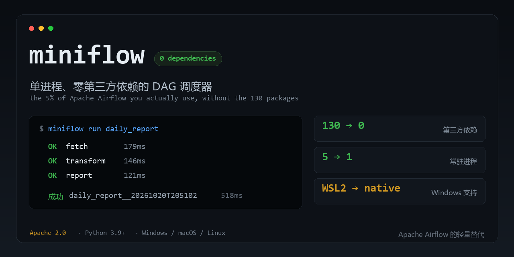

# miniflow



> 只想让 5 个脚本按顺序每天跑一次，不该先装 WSL2、起 5 个常驻进程、拉 130 个包。

单进程、**零第三方依赖**的 DAG 调度器。用一个 `.py` 文件描述工作流，用一条命令跑起来。

```bash
python -m miniflow init demo && cd demo && python -m miniflow run hello_dag
```

```
运行 hello_dag
  OK    fetch                    179ms
  OK    transform                146ms
  OK    report                   121ms

成功  hello_dag__20261020T205102  518ms
```

---

## 1. 它解决什么问题

Apache Airflow 是这个领域的事实标准，但它为「几百个 DAG、跨团队、分布式执行」设计。
个人项目、小团队内部工具、单机数据管道往往只需要其中 5% 的能力，却要承担 100% 的部署成本。

以下是 **2026-10-20 实测**的对比（数据来源见文末）：

| | Apache Airflow 3.3.2 | miniflow 0.1.0 |
|---|---|---|
| GitHub Stars | 47,227 | 本项目（新） |
| 安装需要解析的包 | **130 个**（`pip install apache-airflow`，不含任何 extras） | **0 个**（只用标准库） |
| Windows 支持 | 官方要求 **WSL2** | **原生支持** |
| 需要常驻的进程 | 5 个（api-server / scheduler / dag-processor / triggerer / 元数据库） | 1 个（或 0 个：用系统计划任务调 `run`） |
| 手动部署命令 | 6 条起步（`db migrate` → `users create` → 起 3 个服务） | `miniflow run <dag>` |
| 元数据库 | 必需，需自行准备与迁移 | 内置 SQLite，自动建表 |
| 首次能跑通的时间 | 分钟级（还要处理 constraints 文件与依赖冲突） | 秒级 |

miniflow 不是 Airflow 的复刻，而是把「声明 DAG → 解析依赖 → 按序执行 → 记录状态 → 定时触发」
这条主干抽出来，其余全部砍掉。**它明确不做什么**，见第 6 节。

---

## 2. 安装

### 方式 A：直接用源码（不装任何东西）

```bash
cd miniflow
python -m miniflow --version      # 能打印版本就说明可用
python -m miniflow init demo      # 生成示例到 demo/
cd demo
python -m miniflow run hello_dag
```

要求 Python 3.9+。不需要虚拟环境，不需要 `pip install`。

### 方式 B：装进当前环境（获得 `miniflow` 命令）

```bash
cd miniflow
pip install .
miniflow --version
```

`dependencies = []`，所以这一步不会下载任何第三方包。

### 方式 C：Windows 双击启动

双击 `start.cmd`，它会在当前目录生成示例并跑一次。
（如果提示找不到 Python，请先装 Python 3.9+ 并勾选 "Add to PATH"。）

---

## 3. 核心概念（一共 4 个）

### DAG：一个 `with` 块

```python
from miniflow import DAG, task

with DAG("daily_report", schedule="0 3 * * *", retries=1) as dag:
    ...
```

`schedule` 是标准 5 字段 cron；写 `None` 表示只手动触发，不参与定时调度。

### task：一个普通函数

```python
@task
def extract():
    return {"rows": 120}

@task(retries=2, retry_delay=5, timeout=60)
def transform(extract):        # 参数名 = 上游 task_id
    return {"rows": extract["rows"] * 2}
```

- 每个任务在**独立子进程**里执行：崩了不拖垮调度器，超时能真的杀掉。
- 参数 `retries` / `retry_delay` / `timeout` 可写在 `@task(...)` 上，也可写在 `DAG(...)` 上作为全局默认。
- 返回值会被 JSON 序列化后传给下游。**不可 JSON 序列化的返回值会报 MF006**，不会静默丢数据。

### 依赖：`>>`

```python
extract >> transform >> load
```

支持链式与分叉：

```python
extract >> transform
extract >> audit          # 同一个上游喂给两个下游
transform >> load
```

### 传参：参数名就是上游 task_id

这是 miniflow 唯一需要记的规则。

```python
@task
def load(transform):       # 拿到 transform 的返回值
    print(transform["rows"])
```

如果参数名既不是上游 id、也没有默认值，加载时就会报 **MF005**，并直接告诉你应该改成什么名字。

根任务（没有上游）的必填参数从命令行传：

```bash
miniflow run daily_report --param rows=120
```

`--param` 的值会先按 JSON 解析（`10` → 整数，`true` → 布尔），失败才当字符串。

---

## 4. 命令

| 命令 | 作用 |
|---|---|
| `miniflow init [目录]` | 生成一份能直接跑的示例（DAG + 辅助模块 + 配置） |
| `miniflow list` | 列出所有 DAG、任务数、调度、上次运行 |
| `miniflow show <dag_id>` | 看依赖图、下次触发时间、需要 `--param` 的任务 |
| `miniflow run <dag_id>` | 跑一次 |
| `miniflow run <dag_id> --task <id>` | 只跑到某个任务（含它的上游） |
| `miniflow run <dag_id> --dry-run` | 只打印执行顺序 |
| `miniflow runs` | 运行历史 |
| `miniflow logs <run_id> [--task <id>]` | 看任务日志路径 / 直接打印日志 |
| `miniflow schedule` | 常驻调度循环（Ctrl+C 退出） |
| `miniflow schedule --once` | 只检查一轮，适合交给系统计划任务 |
| `miniflow cron next "0 3 * * *" -n 5` | 校验 cron 并看未来 5 次触发时间 |
| `miniflow doctor` | 体检：Python、依赖、目录权限、状态库、DAG 可加载性 |
| `miniflow clean --keep 50 --force` | 清理旧的运行记录与日志 |

全局参数 `--dags` / `--home` / `--config` 放在子命令前后都行：

```bash
miniflow --dags ./flows run etl
miniflow run etl --dags ./flows
```

`list` / `show` / `runs` / `cron next` 支持 `--json`，方便接脚本。

---

## 5. 配置文件

`miniflow.json`（放在当前工作目录，或用 `--config` / 环境变量 `MINIFLOW_CONFIG` 指定）：

```json
{
  "dags_dir": "./dags",
  "home": "./.miniflow"
}
```

| 键 | 含义 | 默认 |
|---|---|---|
| `dags_dir` | DAG 文件目录 | `./dags` |
| `home` | 状态库与日志目录 | `./.miniflow` |

相对路径以**配置文件所在目录**为基准。
优先级：命令行参数 > 环境变量 `MINIFLOW_HOME` > 配置文件 > 默认值。

目录结构：

```
.miniflow/
├── miniflow.db              # SQLite：运行记录、任务尝试、调度游标
└── logs/
    └── <run_id>/
        └── <task_id>/
            ├── attempt-1.log        # 任务的 stdout + stderr
            ├── attempt-1.spec.json  # 传给子进程的参数
            └── attempt-1.result.json
```

---

## 6. 它不做什么（重要）

miniflow 是**有意的窄工具**。以下能力它没有，也不打算有：

| 没有 | 如果你真的需要 |
|---|---|
| Web UI / 图形化编排 | 用 Airflow、Prefect、Dagster |
| 分布式执行（Celery / K8s Executor） | 用 Airflow，或按 DAG 拆到多台机器各跑各的 |
| 连接/密钥管理后端 | 用环境变量、`.env` 或系统密钥链 |
| 插件系统、Provider 生态（云厂商算子） | 直接在自己任务里 `import` 对应 SDK |
| RBAC / 多租户 / 审计日志 | 用 Airflow 或企业调度平台 |
| 带秒的 cron、`L`/`W`/`#` 扩展 | miniflow 会明确报错（MF009），不会静默算错 |
| 自动补跑历史区间（backfill） | 手动 `run` 多次，或用 `schedule` 的游标机制 |
| SLA 监控、告警通道 | 用外部监控读 `miniflow runs --json` |

一句话判断标准：**如果你的工作流需要多人协作、需要图形界面、需要跨机器分发，请用 Airflow。**
如果它只需要「按顺序、按时间、可靠地跑完并留下日志」，miniflow 够用。

---

## 7. 错误提示

每条错误都有稳定编号、人话原因、修复建议和可执行的下一步命令。

```
[MF005] 任务参数无法绑定  任务 use 的参数 'wrong_name' 绑不到任何上游输出
       原因    miniflow 用「参数名 = 上游 task_id」来传数据，'wrong_name' 既不是上游 id 也没有默认值。
       怎么修  可用参数名：fetch；看起来你想接唯一的上游，把参数名改成 'fetch'。
       下一步  miniflow doctor
       退出码  3
```

退出码约定：

| 码 | 含义 |
|---|---|
| 0 | 成功 |
| 2 | 命令行用法错（找不到 DAG、`--param` 格式错） |
| 3 | DAG 校验失败（成环、参数绑定、cron 非法、文件加载失败） |
| 4 | DAG 结构没问题，任务本身跑失败 |
| 5 | 环境/配置/状态库问题 |

完整错误码表见 [`docs/TROUBLESHOOTING.md`](docs/TROUBLESHOOTING.md)。

---

## 8. 测试

零依赖，用标准库 `unittest`：

```bash
cd miniflow
python -m unittest discover -s tests -t . -v
```

覆盖范围（68 个用例）：

- cron 解析与推进：闰年、月末缺日、day-of-month 与 day-of-week 的 OR 语义、非法表达式
- DAG 结构：拓扑序稳定性、环检测方向、参数绑定、重复 task_id、嵌套 DAG
- 执行器：**真实子进程**跨进程传值、**真实重试**（用计数文件证明函数体执行了 3 次）、
  **真实超时**（60 秒的任务 1 秒被杀）、失败阻断下游但不阻断无关分支、非 JSON 返回值
- 状态库：生命周期、尝试记录、调度游标、清理、损坏库报错
- CLI 端到端：`init` 之后不改任何东西就能 `run` 成功、退出码、`--json`、日志读取

测试有效性用变异检查验证过：故意注入 5 类缺陷（cron 语义、重试次数、失败传播、超时、环检测），
测试全部检测到。脚本见 `tools/mutation_check.py`。

---

## 9. 许可证与归属

- 本项目：**Apache License 2.0**，见 [`LICENSE`](LICENSE)。
- 灵感与概念来源：Apache Airflow（Apache-2.0）。本项目是**独立实现（clean-room）**，
  **没有复制 Airflow 的任何源代码**，归属与商标说明见 [`NOTICE`](NOTICE)。
- "Apache"、"Airflow" 是 Apache Software Foundation 的商标；本项目与 ASF 无隶属关系。

---

## 附：数据来源

- Stars / 许可证：GitHub REST API `repos/apache/airflow`，抓取于 2026-10-20（47,227 stars，Apache-2.0）。
- 依赖数量：`pip install --dry-run --ignore-installed --report dep_report.json "apache-airflow==3.3.2"`，
  pip 解析出 130 个待安装包。核心包 `apache-airflow-core==3.3.2` 自身声明 68 个非 extra 直接依赖。
- Windows 需 WSL2、5 个常驻进程、6 条部署命令：均摘自 Airflow 官方
  [Quick Start](https://airflow.apache.org/docs/apache-airflow/stable/start.html) 与
  [Installation](https://airflow.apache.org/docs/apache-airflow/stable/installation/index.html)（3.3.2 文档）。

这些数字会随上游版本变化，复现方法见 [`docs/DEPLOY.md`](docs/DEPLOY.md) 末尾。
